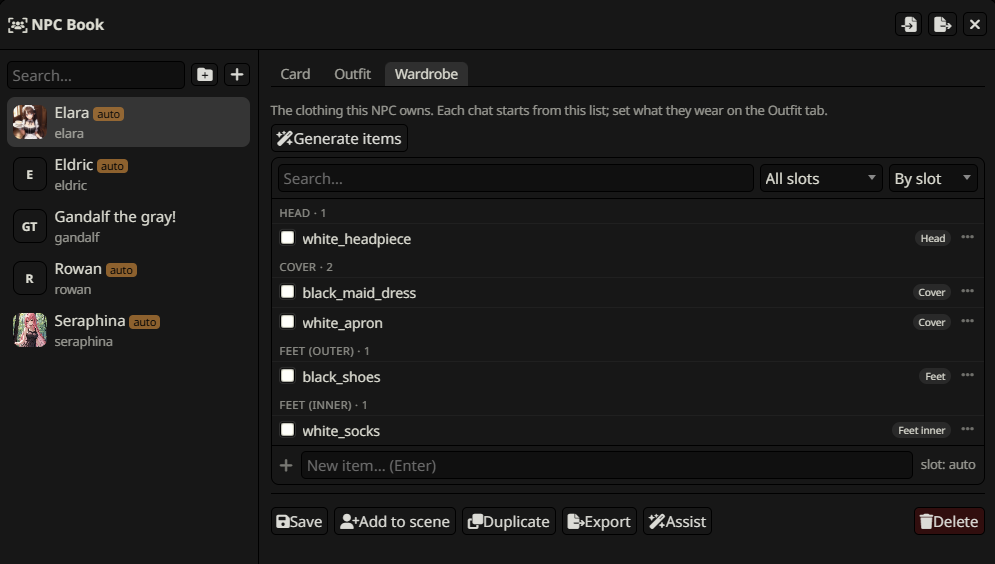
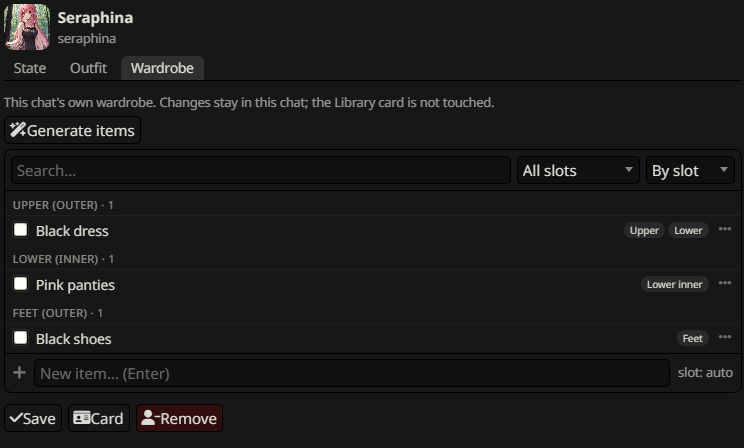

# NPC Book — Wardrobe

A sister extension for [NPC Book](https://github.com/lalzy/ST-NPC-Book)

NPC Book already has an simple outfit system allowing user or LLM to attach any clothing to the paper doll, this extension adds a **wardrobe** to each character/user that tells the LLM what the character has access to in events it wants to dress it.

### Features
- Per instance (and template) wardrobe.
- Tells LLM to only allow NPC to equiped what is in it's wardrobe
- NPC can get new clothing (being given it, buys it, etc, or you just admin-generate it)
- Have the LLM generate outfits matching the character.

## Install
Install it like any SillyTavern extension (Extensions → Install extension, or copy this folder to `SillyTavern/data/<your-user>/extensions/`), next to NPC Book.

## How it is built
Only through NPC Book's public API (`window.NPCBook`), so it is also a full example for writing your own sister extension. See NPC Book's `EXTENDING.md`. Hooks used: `cardTab` (with `chatTab`), `personaSheet`, `outfitCatalog`, `transformEntry`, `fromTracker`, `onTrackerEntry`, `entryKeys`, `sceneXml` (`sceneXmlAlways`), `instructions`.
